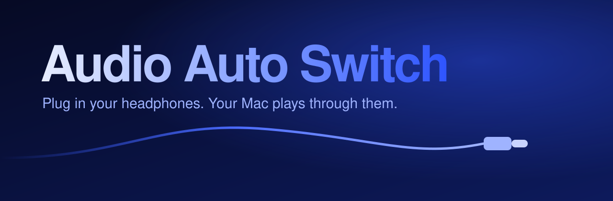

<p align="center">
  
</p>

# Audio Auto Switch

A small menu bar app for macOS. When you plug in your USB or USB-C headphones, it switches your Mac's sound to them.

I made it for my **Bose Noise Cancelling Wired Earbuds (USB-C)**. When I plugged them into my MacBook Pro, the microphone switched over but the sound kept coming out of the speakers, so I had to open Sound settings every time. With this app, the sound moves to the earbuds when I plug them in.

It works with any audio device you can plug in, such as USB-C earbuds, USB headsets, USB DACs, and docks with a headphone jack.

## How to use it

1. Open the app. A headphones icon appears in the menu bar.
2. Plug in your headphones.
3. Click the icon and tick your headphones.

From then on, your Mac plays through them whenever you plug them in. When you unplug them, macOS goes back to your speakers like it normally does.

Turn on **Open at Login** in the same menu so you don't have to start the app yourself.

## Install

**[Download Audio Auto Switch](https://github.com/ishanray/AudioAutoSwitch/releases/latest/download/AudioAutoSwitch.zip)**

Unzip it, drag **Audio Auto Switch** into Applications, and open it. The app is signed and notarized by Apple.

Requires macOS 13 Ventura or later. Runs on Apple silicon and Intel Macs.

### Build from source

You need Xcode or the Xcode Command Line Tools.

```sh
git clone https://github.com/ishanray/AudioAutoSwitch.git
cd AudioAutoSwitch
./scripts/build-app.sh
open build
```

To make a signed and notarized release, sign in to your Apple developer account in Xcode → Settings → Accounts, then run:

```sh
TEAM_ID=<your team ID> ./scripts/release.sh
```

## Why doesn't my Mac switch to USB headphones on its own?

macOS switches to the headphone jack and to AirPods, but it often keeps playing through the current output when you plug in a USB device. Apple doesn't document the rules. Other people report the same thing with USB-C earbuds, USB headsets, and docks. Picking the device once in System Settings → Sound fixes it for some people. This app is for when it doesn't.

## How it works

The app listens for Core Audio device changes. When one of your ticked devices connects, it becomes the output for sound and for alerts. Devices are remembered by their unique ID, so two pairs of the same headphones are tracked separately.

It has no network access and collects nothing. All the code is in [`Sources/AudioAutoSwitch`](Sources/AudioAutoSwitch).

## License

[MIT](LICENSE)
